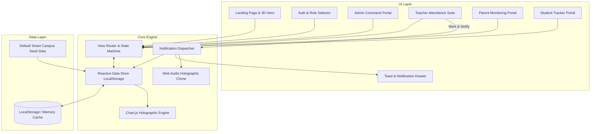
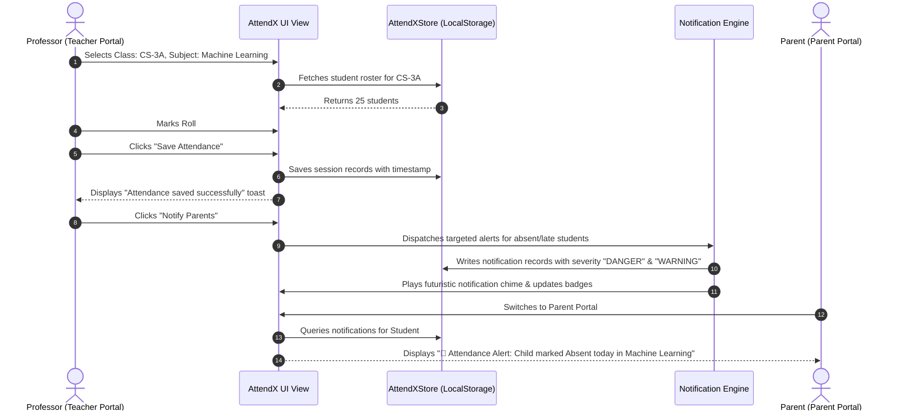

# AttendX System Architecture Specification
## Smart Attendance Monitoring & Parent Notification System

**Document Version:** 1.0.0  
**Target Environment:** Web Browser (Modern ECMAScript, HTML5, CSS3, Web Audio API, LocalStorage)  
**Architectural Style:** Modular Single Page Application (SPA) with Reactive Local Data Bus  

---

### 1. High-Level System Architecture

AttendX employs a decoupled client-side architecture where state management, business logic, visual representation, and audio feedback operate cohesively.

---

### 2. Frontend Component Architecture

The application is structured into clearly delineated modular components:

1. **App Shell (`index.html`)**
   - **Background Layer:** Interactive cyber-grid Canvas (`#cyberCanvas`) running a 60fps particle and starfield simulation.
   - **Navigation Header:** Live campus clock, role indicator badge, quick role-switch modal trigger, search input, notification bell with unread badge counter, and user profile pill.
   - **Sidebar Navigation:** Collapsible glassmorphic sidebar featuring glowing active state indicators, role-scoped links, and logout trigger.
   - **Main Content Stage:** Dynamic view container that swaps active views with smooth fade-and-lift CSS keyframe animations.
   - **Overlays & Modals:** Role Login Modal, Student Add/Edit Modal, Notification Compose Modal, Day Attendance Details Modal, and Print Preview.
   - **Global Notification Drawer & Toast Container:** Stacked non-intrusive alerts with synthesized sound playback.

2. **Style & Design System (`css/style.css`)**
   - **CSS Custom Properties (Variables):** Standardized color palettes (Deep Space Navy, Cyan Laser, Electric Violet, Emerald Glow, Amber Warn, Coral Alert).
   - **Glassmorphism Utility Engine:** Multi-layered translucent panels (`background: rgba(13, 20, 44, 0.7)`, `backdrop-filter: blur(16px)`, `border: 1px solid rgba(0, 240, 255, 0.15)`).
   - **3D Transform & Tilt Matrix:** Hover perspective rotations (`perspective: 1000px`, `transform: rotateY(...) rotateX(...)`).
   - **Responsive Breakpoint Grid:** Flexbox and CSS Grid layout rules for mobile (<768px), tablet (768px-1024px), desktop (1024px-1440px), and ultra-wide (>1440px).

3. **Data & State Management (`js/store.js` & `js/data.js`)**
   - **Initial Seed Factory:** Populates a rich dataset of 4 academic classes, 30+ students, realistic attendance histories, predefined subjects, and parent linkages if LocalStorage is uninitialized.
   - **Store Controller (`AttendXStore`):** Provides atomic methods for:
     - `getStudents()`, `addStudent(data)`, `updateStudent(id, data)`, `deleteStudent(id)`.
     - `getAttendanceRecords(filter)`, `saveAttendance(classId, subjectId, date, records)`.
     - `getNotifications(role, targetId)`, `sendNotification(payload)`, `markNotificationRead(id)`.
     - `getCampusStats()`, `getStudentStats(studentId)`.
     - `getCurrentUser()`, `setCurrentUser(user)`, `logout()`.

4. **Visual Analytics Engine (`js/charts.js`)**
   - Encapsulates Chart.js instances with custom glowing neon gradients, dark tooltips, futuristic gridlines, and responsive canvas redraw handlers.
   - Supports Attendance Trend (Line), Present/Absent/Late (Doughnut), and Class Comparison (Bar) charts.

5. **Audio Synthesizer Engine (`js/app.js`)**
   - Utilizes standard browser `AudioContext` to synthesize futuristic UI tones (soft cyber chimes for success, alert frequencies for warnings) without requiring external audio assets.

---

### 3. Data Flow Specification

#### 3.1 Attendance Logging & Instant Parent Alert Flow

---

### 4. Storage Model (HTML5 LocalStorage Schema)

The application stores data under the namespace `attendx_v1_*`:

| Key Name | Type | Description |
|---|---|---|
| `attendx_v1_currentUser` | `Object` | Active session: `{ id, name, role, email, avatar, studentId? }` |
| `attendx_v1_students` | `Array<Student>` | Student roster: `{ id, name, rollNo, class, email, parentName, parentPhone, parentEmail, overallAttendance, avatar }` |
| `attendx_v1_attendance` | `Array<Record>` | Daily lecture logs: `{ id, classId, subjectId, date, records: [{ studentId, status: 'present'\|'absent'\|'late' }] }` |
| `attendx_v1_notifications` | `Array<Notification>` | Alert logs: `{ id, type, title, message, date, studentId?, classId?, severity, read: boolean }` |
| `attendx_v1_messages` | `Array<Message>` | Parent-Teacher communication thread logs |

---

### 5. Security & Privacy Considerations
1. **Role-Based Access Control (RBAC):** UI views and actions are strictly constrained to the authenticated role. Sensitive operations (student deletion, institutional settings) are blocked for students and parents.
2. **Client-Side Data Sanitization:** All user inputs (student registration, custom notification messages) are sanitized before rendering into the DOM to prevent Cross-Site Scripting (XSS).
3. **No External Credential Exposure:** Authentication uses sandboxed local tokens, suitable for rapid prototype demonstrations and defense presentations.
4. **Data Isolation:** Parents are strictly scoped to access only their linked child's attendance metrics and private notifications.
