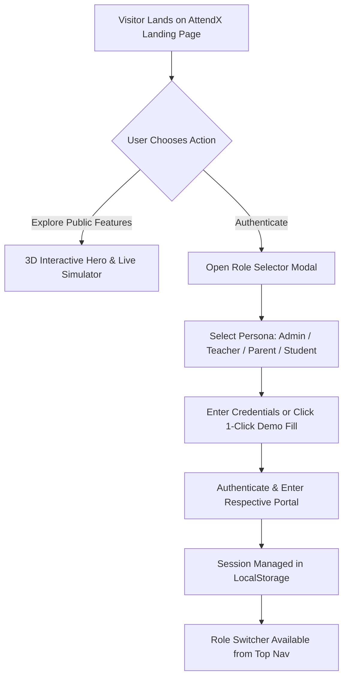
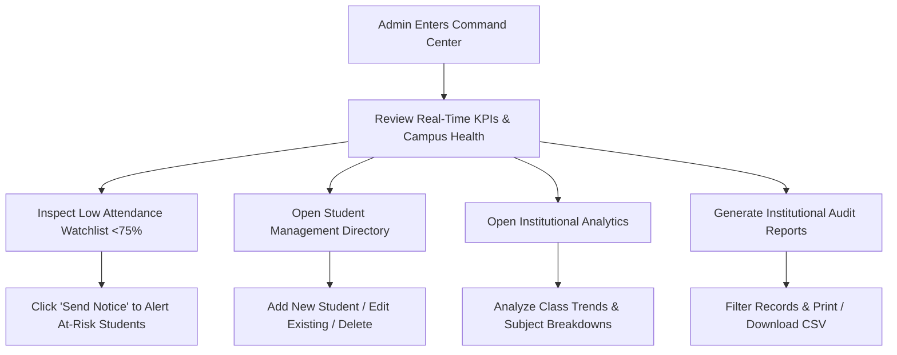
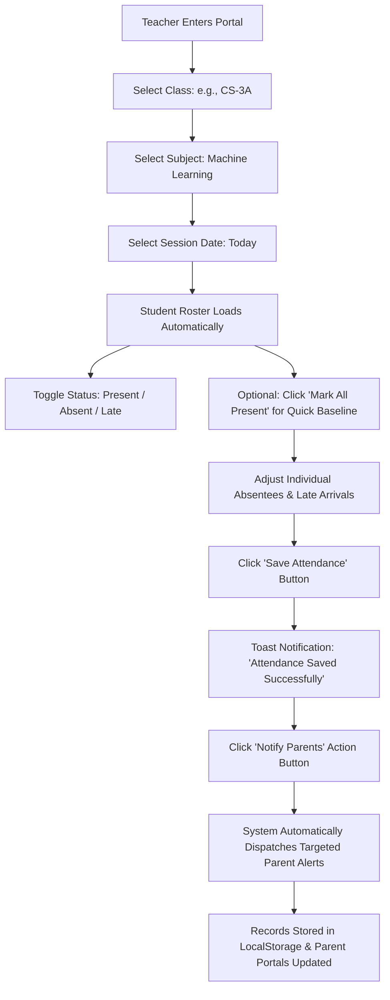
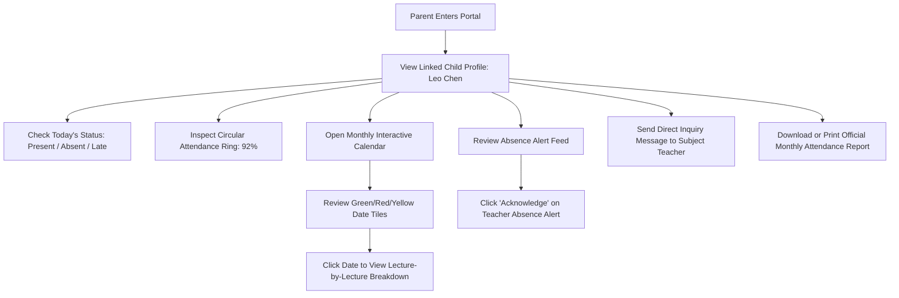
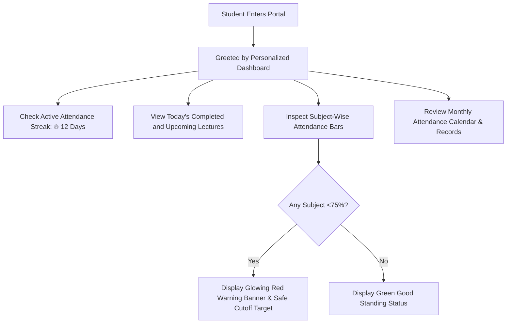
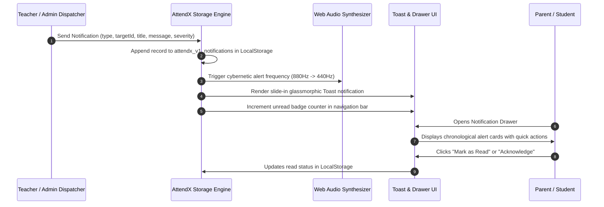

# AttendX Complete User & Operational Flows
## End-to-End User Journey & Interaction Workflows

**Version:** 1.0.0  
**Project:** AttendX – Smart Attendance Monitoring & Parent Notification System  

---

### 1. High-Level Universal User Journey

---

### 2. Admin Operational Flow

**Step-by-step Execution:**
1. Login with Admin credentials (`admin@attendx.edu` / `admin123`).
2. Verify total active students (1,250), present count (1,156), and campus average (92.4%).
3. Track real-time attendance trends on dynamic neon charts.
4. Drill down to students with low attendance (<75%) and trigger direct reminders.
5. Search or filter the student directory; add new students with parent contact links.

---

### 3. Teacher Operational Flow (Attendance Taking & Parent Dispatch)

**Step-by-step Execution:**
1. Login with Teacher credentials (`prof.elena@attendx.edu` / `teacher123`).
2. Select target class and subject.
3. Roster dynamically displays students with instant status buttons (🟢 Present, 🔴 Absent, 🟡 Late).
4. Teacher marks attendance with live status counters tallying totals.
5. Click **"Save Attendance"** -> triggers local persistence and success banner.
6. Click **"Notify Parents"** -> automated dispatch sends notifications specifically to parents whose children are marked absent or late.

---

### 4. Parent Operational Flow (Real-Time Child Monitoring)

**Step-by-step Execution:**
1. Login with Parent credentials (`parent.sharma@attendx.edu` / `parent123`).
2. Immediately observe child's real-time campus presence and attendance percentage.
3. Check notification feed: if child was marked absent today by the teacher, a high-priority red alert card is visible.
4. Parent clicks "Acknowledge" to log receipt of the alert.
5. Parent uses the internal message composer to communicate with the professor if leave was pre-authorized.
6. Downloads or prints the verified attendance statement.

---

### 5. Student Operational Flow (Self-Tracking & Engagement)

**Step-by-step Execution:**
1. Login with Student credentials (`student.leo@attendx.edu` / `student123`).
2. Personalized dashboard presents attendance streak and today's timetable.
3. Student inspects subject progress bars (e.g., Mathematics: 94%, CS: 91%, English: 96%, Physics: 87%).
4. If attendance dips under 75%, an interactive warning banner advises how many consecutive lectures are needed to restore good standing.

---

### 6. Notification Engine Flow

